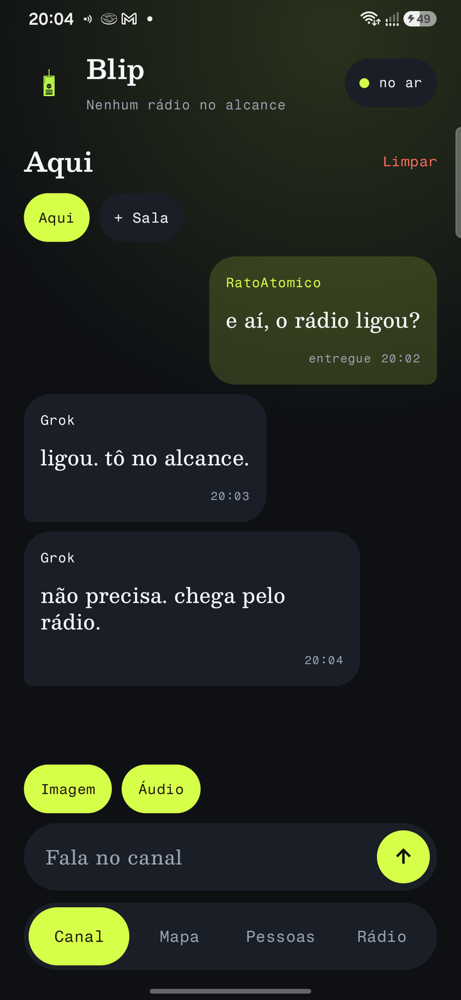
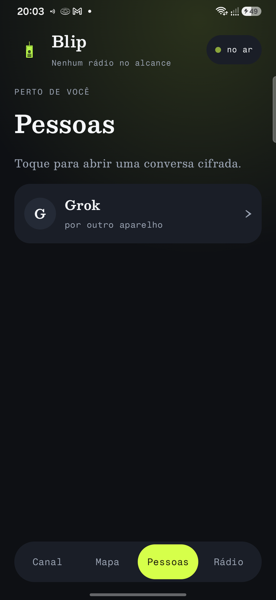
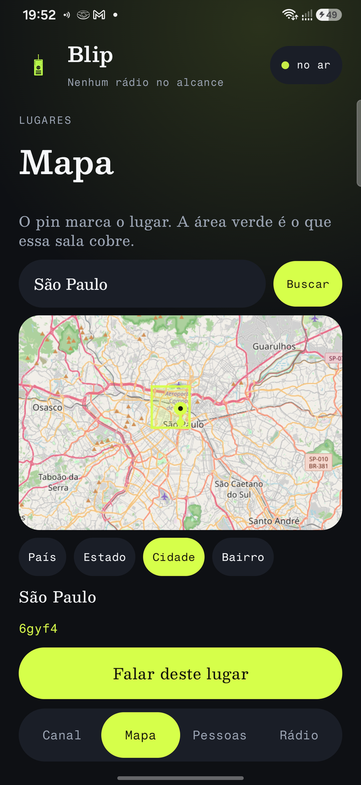

# Blip

[Português](README.md)

A chat and a walkie-talkie for Android. No account and no phone number. The name and the identity stay on this phone.

The channel is where you write. The radio is where you talk: hold the button, speak, let go. Nearby phones pass the voice along, even with no internet. If nobody is close enough to pass it on, the voice tries the internet.

<p>
  
  
  
</p>

The shots are a sample of the channel, the people list, and the map. The app opens in English. The language can be changed in Settings.

## Screens

- **Channel.** Text, images, and voice notes.
- **Radio.** The walkie-talkie. Hold to talk, release to send. The voice goes to everyone on the channel. When someone else talks, the phone plays it.
- **Map.** The pin stays in the center. Search takes a country, city, or neighborhood. Country, State, City, and Neighborhood change how large the area is, painted in pale green.
- **People.** Who is nearby, for a direct chat.
- **Menu.** Opens Settings only.

## Settings

- **Internet and local** looks for nearby phones and also tries the internet. **Internet only** does not look for nearby phones. Talk goes over the internet.
- Turn the link on or off, the battery note, and the diary.
- Language. English is the default. The other languages in the list can be chosen.
- Name, the identity fingerprint, and erasing everything on this phone by typing `LIMPAR`.

A place room on the map does not cross the internet. Two phones on the same point only meet when they are in range.

## What is sealed

Every packet is signed with Ed25519. A bad signature is thrown away.

A direct chat, and the audio or image in it, is sealed for one phone: a fresh X25519 key, HKDF-SHA256, and ChaCha20-Poly1305. Only that phone can open it.

A room with a password seals its text and media with that password: PBKDF2-HMAC-SHA256, 50,000 rounds, then ChaCha20-Poly1305.

The public channel, place rooms, and rooms without a password are signed, but anyone who receives them can read them. The name can be seen too. What is saved on this phone is not locked.

## Internet

There is no public relay. `relay/relay.py` runs a local relay on port 8791. The app talks to `http://127.0.0.1:8791`. On Waydroid it uses `http://192.168.240.1:8791`.

```bash
python3 relay/relay.py
```

On a phone plugged in over USB, the relay on this computer is reachable only after `adb reverse tcp:8791 tcp:8791`. If the relay is down, messages wait. Direct chats stay sealed on that path. The public channel can be read by anyone on it, including the relay.

## Build

Android 12 or newer (minSdk 31), with Google Play Services. This project's Gradle needs JDK 17.

```bash
export JAVA_HOME=/usr/lib/jvm/java-17-openjdk-amd64
./gradlew :mesh-core:test :app:assembleDebug
```

The debug APK is written to `app/build/outputs/apk/debug/app-debug.apk`.

Each push to `main` also builds that APK on GitHub, in the **APK** action, under Artifacts, named `blip-debug`.
