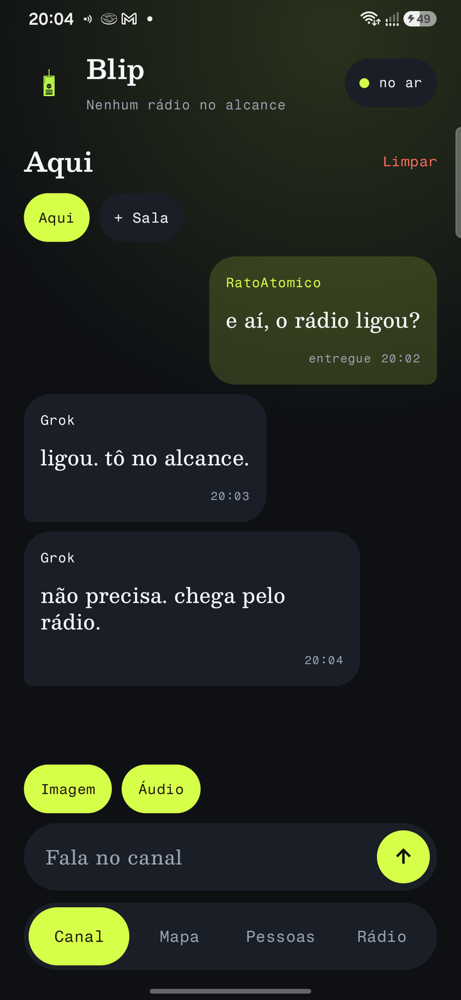
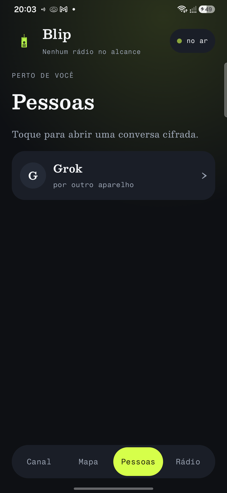
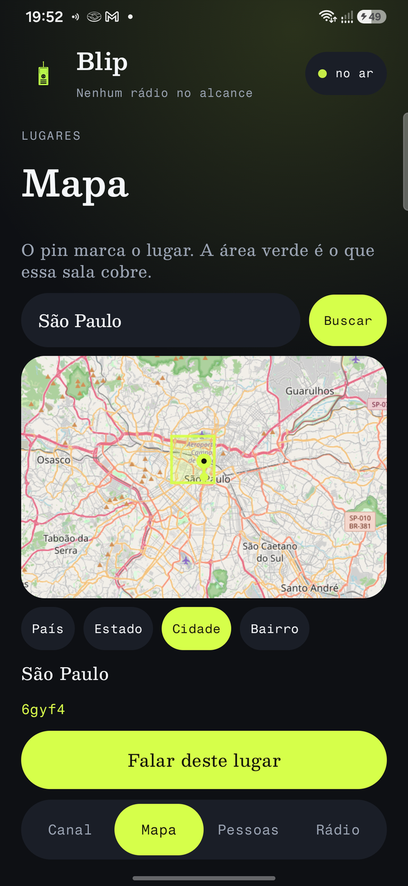

# Blip

[English](README.en.md)

Chat e walkie-talkie para Android. Sem conta e sem número de telefone. O nome e a identidade ficam neste aparelho.

No canal se escreve. No rádio se fala: segura o botão, fala e solta. Os aparelhos perto passam a voz adiante, mesmo sem internet. Se não tem ninguém perto para passar, a voz tenta a internet.

<p>
  
  
  
</p>

As capturas são um exemplo do canal, das pessoas e do mapa. O app abre em inglês. O idioma muda nos Ajustes.

## Telas

- **Canal.** Texto, imagem e nota de voz.
- **Rádio.** O walkie-talkie. Segura para falar, solta para enviar. A voz vai para todo mundo no canal. Quando outra pessoa fala, o aparelho toca.
- **Mapa.** O pin fica no centro. A busca aceita país, cidade ou bairro. País, Estado, Cidade e Bairro mudam o tamanho da área, pintada em verde claro.
- **Pessoas.** Quem está por perto, para uma conversa direta.
- **Menu.** Abre só os Ajustes.

## Ajustes

- **Internet e local** procura aparelhos perto e também tenta a internet. **Só internet** não procura aparelhos perto. A fala sai pela internet.
- Ligar e desligar a ligação, o aviso da bateria e o diário.
- Idioma. O padrão é inglês. Dá para escolher os outros idiomas da lista.
- Nome, impressão digital da identidade, e apagar tudo neste aparelho digitando `LIMPAR`.

A sala de um lugar no mapa não atravessa a internet. Dois aparelhos no mesmo ponto só se encontram se estiverem no alcance.

## O que fica cifrado

Cada pacote é assinado com Ed25519. Assinatura ruim é descartada.

A conversa direta, e o áudio ou a imagem nela, são cifrados para um aparelho só: uma chave X25519 nova, HKDF-SHA256 e ChaCha20-Poly1305. Só aquele aparelho abre.

Sala com senha cifra o texto e a mídia com essa senha: PBKDF2-HMAC-SHA256, 50 mil voltas, depois ChaCha20-Poly1305.

O canal público, as salas de lugar e as salas sem senha são assinados, mas quem recebe consegue ler. O nome também aparece. O que fica salvo neste aparelho não está trancado.

## Relay

O Blip não publica um relay. Quem quiser que a conversa atravesse a internet sobe o `relay/relay.py` no próprio servidor. É um processo Python, com a biblioteca padrão, que fica ligado e guarda a fila na memória. Não é um Worker.

O app pergunta esse relay a cada 2 segundos. Três caminhos:

- `POST /v1/hello` com `{"id","name"}`. Marca o aparelho como presente. Quem fica 25 segundos sem falar some da lista.
- `POST /v1/push` com `{"id","to","packet"}`. `packet` é o pacote do Blip em base64. A fila de cada destino guarda no máximo 200 pacotes. Um pacote maior que 300 mil caracteres em base64 é recusado.
- `GET /v1/pull?id=` devolve quem está presente e tira da fila o que era daquele aparelho.

O relay não abre os pacotes. A direta continua cifrada. O canal público pode ser lido por quem estiver nesse caminho, inclusive por quem administra o servidor. Sala de lugar não é enviada. Não há senha: quem alcançar o endereço pode enviar. A fila se perde quando o processo reinicia. Se o relay está fora, as mensagens esperam no aparelho.

No celular comum o app fala com `http://127.0.0.1:8791`. No Waydroid, com `http://192.168.240.1:8791`. HTTP sem cifra só é aceito nesses endereços e em `localhost`.

Neste computador:

```bash
python3 relay/relay.py
```

Ele escuta em `0.0.0.0:8791`. Com o celular no USB:

```bash
adb reverse tcp:8791 tcp:8791
```

Para um servidor na internet, copie `relay/relay.py` para a máquina e deixe o processo no ar. Python 3 basta. Nada para instalar com pip.

```bash
python3 relay/relay.py
```

Um serviço systemd mantém o processo depois de reiniciar. Ajuste o caminho do script.

```ini
[Unit]
Description=Blip relay
After=network.target

[Service]
ExecStart=/usr/bin/python3 /opt/blip/relay.py
Restart=on-failure
User=blip

[Install]
WantedBy=multi-user.target
```

Abra a porta 8791 só para o proxy, não para a internet inteira. Na frente, um Caddy ou nginx com HTTPS encaminha `/v1/hello`, `/v1/push` e `/v1/pull` para `127.0.0.1:8791`. O celular precisa de `https://`, porque um endereço público em HTTP é bloqueado.

O endereço está em `relayBase()` dentro de `app/src/main/java/dev/vereda/app/mesh/InternetMeshTransport.kt`. Troque pelo `https://seu.dominio` e gere o APK de novo. Sem essa troca, o app continua falando só com o relay local.

## Build

Android 12 ou mais novo (minSdk 31), com Google Play Services. O Gradle deste projeto precisa de JDK 17.

```bash
export JAVA_HOME=/usr/lib/jvm/java-17-openjdk-amd64
./gradlew :mesh-core:test :app:assembleDebug
```

O APK de debug sai em `app/build/outputs/apk/debug/app-debug.apk`.

Cada push na `main` também gera esse APK no GitHub, na ação **APK**, em Artifacts, com o nome `blip-debug`.
